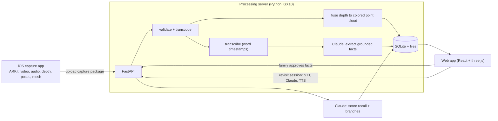

# Braindance: build plan for Claude Code

Working name: **Braindance**. Cal Hacks 13.0, submission deadline **Sunday Oct 25, 9:00 AM PT** (hard). Primary track: Anthropic "Claude for Public Benefit". Secondary: Cal Hacks People-First Social Impact, Meta "Bringing People Closer Together", Cartesia (voice), Most Technically Advanced.

Read this whole file before writing code. Section 15 tells you how to work. Also read `TASKS.md` to see which slice you own; `IOS_CAPTURE_PLAN.md` replaces Section 4.

---

## 0. Ground rules

1. **Hackathon rule: all work must happen during the event.** The `IBS27/rumi` repo came from HackMIT 2026. Do **not** copy files or code blocks from it. Use it only as a reference for which Apple APIs work and what pitfalls exist (Section 4.9 lists what to learn from it). Write every line of this project fresh, and the team will credit Rumi as prior reference in the Devpost.
2. **Nothing fake.** Never show mock or fixture data in the UI as if it came from a real capture or a real patient session. Fixtures belong in tests only. If a step fails, the UI shows the failure.
3. **Grounded or nothing.** Claude never says anything to the person with dementia that the recording doesn't support. Code enforces this (Section 7.4).
4. **Ship the loop first.** One real capture must travel through the entire pipeline before anyone polishes anything.

---

## 1. What we're building

A family member films a visit with a LiDAR iPhone. Braindance turns the recording into a moment the person with dementia can step back into over the following days. Claude narrates it gently, talks with them about it, and measures which details they hold onto. The family sees recall over time and any older memories the moment brought up.

**Named community:** families who visit a parent with mild-to-moderate Alzheimer's living in memory care.

**Why no photoreal reconstruction:** we don't need a Gaussian splat. We need the *moment*: the room, the people moving in it, what they said. So we capture synchronized **video + audio + LiDAR depth + camera poses + a coarse mesh**, and render the room as a stylized point cloud with the people replayed in 3D from per-frame depth. This works more cheaply and more honestly, and it looks like the Cyberpunk braindance editor.

### Demo script (3 minutes)
1. Hook: "The morning after the whole family came for her birthday, she asked when someone would visit."
2. Show the iPhone capture app recording a short visit (pre-recorded clip of capture plus the real result).
3. Family view: Claude extracted the moment's facts, each linked to the exact frame or quote. The family approves them.
4. Patient view on a tablet: the room appears, people replay in 3D, Claude narrates ("This is Sunday. Priya brought the mango cake you love.") in a warm voice.
5. "Grandma" says "this kitchen looks like my mother's." Claude invites the story and logs a branch.
6. Dashboard: recall chart across the sessions we actually ran this weekend, plus the branch.
7. Close: research basis (SenseCam/Woodberry 2015) and the pilot plan.

---

## 2. Architecture



### Repo layout (monorepo)
```
braindance/
  ios/BraindanceCapture/          # SwiftUI app, no third-party deps
  server/                         # Python 3.11, uv, FastAPI
    app/main.py
    app/pipeline/{ingest,transcode,transcribe,pointcloud,facts}.py
    app/claude/{prompts.py,client.py,grounding.py}
    app/session/{revisit.py,scoring.py}
    app/db.py
    tests/
  web/                            # Vite + React + TypeScript + React Three Fiber
    src/views/{FamilyUpload,FactReview,Revisit,Dashboard}.tsx
    src/scene/{StaticCloud,DepthReplay,CameraPath}.tsx
  docs/capture-format.md          # copy of Section 5, the contract between teams
  CLAUDE.md                       # this plan, trimmed
```

---

## 3. Team split (three people)

| Owner | Area | First deliverable |
|---|---|---|
| A | iOS capture app | A real capture package on a laptop by ~10:00 Sat |
| B | Server pipeline + all Claude calls | Transcript + fused cloud + facts from that package |
| C | Web: viewer, revisit session, dashboard | Static cloud + synced video in the browser |

The capture package format (Section 5) and the REST API (Section 6.6) form the contract. Freeze both in the first hour. Until A has a real capture, B and C work against a tiny synthetic package generated by `server/tests/make_fixture.py` (a few frames of a synthetic box room with known geometry), which also tests the unprojection math.

---

## 4. iOS capture app (owner A)

> **Superseded by `IOS_CAPTURE_PLAN.md`.** The app now builds a SiteScape-style colored point cloud **on the phone** during a room scan, then records the moment in the same ARKit session. The phone exports `room.ply` and `room.bin`; the server's fusion in Section 6.4 becomes a fallback only. The notes below remain as background; where they conflict, follow `IOS_CAPTURE_PLAN.md`.

### 4.1 Targets and permissions
- iOS 17.0+, SwiftUI, Swift 5 mode, LiDAR iPhone only (`ARWorldTrackingConfiguration.supportsFrameSemantics(.sceneDepth)`). Reject the simulator with a clear screen.
- Info.plist: `NSCameraUsageDescription`, `NSMicrophoneUsageDescription`.
- No RoomPlan. We don't need dimensions or furniture boxes.

### 4.2 ARKit configuration
```swift
let config = ARWorldTrackingConfiguration()
config.frameSemantics = [.smoothedSceneDepth]      // fall back to .sceneDepth if unsupported
config.sceneReconstruction = .mesh                 // coarse room mesh, exported at stop
config.providesAudioData = true                    // audio arrives on the same session clock
config.environmentTexturing = .none
// Keep the default video format (1920x1440 @ 30 fps on most devices). Don't use 4K.
session.run(config)
```
Using ARKit's own audio keeps audio and video on one clock, which makes sync much easier than a separate AVAudioEngine.

### 4.3 What gets recorded

| Stream | Rate | Storage |
|---|---|---|
| Video (`frame.capturedImage`) | every frame (~30 Hz) | `video.mov`, HEVC via `AVAssetWriter` + `AVAssetWriterInputPixelBufferAdaptor`, `expectsMediaDataInRealTime = true` |
| Audio (`session(_:didOutputAudioSampleBuffer:)`) | continuous | AAC track inside the same `video.mov` |
| Pose + intrinsics + tracking state | every frame | one JSON line per frame in `frames.jsonl` |
| Depth (`smoothedSceneDepth.depthMap`, Float32 256×192) | 10 Hz | converted to **UInt16 millimeters**, appended to a single `depth.bin` |
| Depth confidence (UInt8 256×192) | 10 Hz, same frames | appended to `confidence.bin` |
| Mesh (`ARMeshAnchor`s) | once, at stop | `mesh.ply`, binary little-endian, vertices transformed to world space |
| Thumbnail | once | `thumb.jpg` from a mid-recording frame |

Timestamps: take `t0` = the first video frame's `frame.timestamp`. Write every sample at `CMTime(seconds: ts - t0, preferredTimescale: 600)`. Retime audio buffers the same way using their presentation timestamp. **Verify sync with a clap test** (clap on camera, check the waveform spike lines up with the hands in the browser).

### 4.4 Threading rules (ARKit stalls if you break these)
- The `ARSessionDelegate` callback must return fast and must **not** retain `ARFrame`s. Append the pixel buffer to the writer immediately, copy the 10 Hz depth and confidence into `Data` right there, then hand the `Data` to a serial `DispatchQueue` for file writes.
- Never keep an array of `ARFrame`s. Xcode will log "delegate is retaining N ARFrames" if you do.
- Keep the screen awake while recording (`isIdleTimerDisabled`), and restore it on every exit path.
- Watch `ProcessInfo.thermalState`. At `.serious`, show a warning; stop automatically at `.critical`. Cap recordings at 3 minutes.

### 4.5 Coordinate conventions (write these into the manifest)
- World: ARKit world, meters, right-handed, **y up**, gravity aligned.
- `cameraTransform`: 4×4 camera-to-world, **column-major**, 16 floats.
- ARKit camera space: x right, y up, camera looks down **−z**.
- `capturedImage` and the depth map come in the sensor's native **landscape** orientation regardless of how the user holds the phone. Store them as-is and record `"imageOrientation": "landscapeRight"`. The web rotates for display.
- Intrinsics `K` refer to the full-resolution video frame. Depth pixel (u, v) maps to video pixel (u·W/256, v·H/192).

### 4.6 Screens
1. **Home:** "Record a visit", list of local captures with status.
2. **Recording HUD:** big stop button, timer, tracking state ("Move slowly" when limited), depth OK indicator, mic level meter, warning when thermal or storage gets low. Gentle guidance: "Film the room first, then the people."
   - **Stretch: SiteScape-style coverage overlay.** Accumulate a sparse colored point cloud on the phone from the 10 Hz depth frames (every 4th pixel, confidence 2 only, voxel hash at ~3 cm, hard cap ~1M points) and draw it over the camera view so the filmer sees which parts of the room are captured and where gaps remain. Base it on Apple's sample "Displaying a point cloud using scene depth." This is **preview only**: the raw depth, video and poses still get recorded and uploaded, and the server fusion in Section 6.4 still produces the real cloud. Skip it entirely if the phone gets hot or frames drop.
3. **Review:** play back `video.mov`, show duration and frame count, name the moment ("Sunday lunch at Mom's"), enter who attended (free text, optional).
4. **Send:** upload to server with progress, or share via AirDrop as a backup.

### 4.7 Upload
- Server URL + token come from a QR code the web app shows (`braindance://pair?url=...&token=...`), or from a settings text field as a fallback.
- Upload **each file separately** with `URLSession.uploadTask(with:fromFile:)` to `PUT /api/captures/{id}/files/{name}`, then `POST /api/captures/{id}/complete`. Retry a failed file up to three times. Don't build one giant ZIP in memory: a 3-minute capture can exceed 150 MB.
- AirDrop backup: zip the capture folder with `NSFileCoordinator` using `.forUploading` (built-in, no dependency), then present a share sheet.

### 4.8 Venue networking
Venue Wi-Fi often blocks device-to-device traffic. Expose the GX10 server through a tunnel (`cloudflared tunnel` or Tailscale Funnel) and give the phone the HTTPS URL. AirDrop to a laptop remains the fallback.

### 4.9 What to learn from Rumi (reference only, don't copy)
- It ran RoomPlan; we drop that and own the `ARSession` directly, which also frees the session delegate for us.
- Its lifecycle token pattern (a UUID per attempt that ignores late callbacks) works well for start/stop races. Implement the same idea fresh.
- It sampled `currentFrame` on a timer because RoomPlan owned the delegate. We get every frame from the delegate instead.
- Its blur check and "slow down" guidance help photo quality. We record continuous video, so a simple "moving too fast" hint based on pose velocity covers it.
- Its custom ZIP writer caps out near 126 MB, which is too small for video. Use per-file upload and `NSFileCoordinator` instead.
- Its scene-phase handling (fail an active capture when the app backgrounds) still applies.

### 4.10 Done when
On a real iPhone, a 60-second recording produces a package that the server validates, and the clap test shows audio within ±1 frame.

---

## 5. Capture package format v1 (the contract)

```
capture-<uuid>/
  manifest.json
  video.mov          # HEVC video + AAC audio, timestamps start at 0
  frames.jsonl       # one line per video frame
  depth.bin          # N depth frames × 256×192 × UInt16 (mm), little-endian, row-major
  confidence.bin     # N frames × 256×192 × UInt8 (0 low, 1 medium, 2 high)
  mesh.ply           # optional; world-space binary PLY
  thumb.jpg
```

`manifest.json`:
```json
{
  "format": "braindance.capture",
  "version": 1,
  "id": "uuid",
  "createdAt": "2026-10-24T18:30:00Z",
  "device": "iPhone 15 Pro",
  "title": "Sunday lunch at Mom's",
  "attendees": ["Priya", "Dev"],
  "coordinates": "arkit-world-meters-y-up",
  "imageOrientation": "landscapeRight",
  "video": { "file": "video.mov", "width": 1920, "height": 1440, "fps": 30, "durationSec": 61.2, "frameCount": 1836 },
  "audio": { "inVideo": true, "sampleRate": 48000, "channels": 1 },
  "depth": { "file": "depth.bin", "confidenceFile": "confidence.bin", "width": 256, "height": 192, "unit": "mm", "rateHz": 10, "count": 612 },
  "mesh": { "file": "mesh.ply", "present": true },
  "warnings": []
}
```

`frames.jsonl`, one line per video frame:
```json
{"i":0,"t":0.0,"T":[16 floats, column-major camera-to-world],"K":[fx,fy,cx,cy],"track":"normal","d":0}
```
`d` holds the index into `depth.bin`/`confidence.bin` when this frame has depth, otherwise `null`. Depth frame `k` starts at byte offset `k·256·192·2`.

---

## 6. Processing server (owner B)

Python 3.11 managed with `uv`. Dependencies: `fastapi`, `uvicorn`, `numpy`, `open3d`, `anthropic`, `faster-whisper`, `pydantic`, `python-multipart`; `ffmpeg` on PATH. Storage: SQLite (`server/data/braindance.db`) plus one folder per capture under `server/data/captures/`. Runs on a GX10; CPU fallback must still work.

### 6.1 Ingest
Validate the manifest against a Pydantic model, check file sizes against counts (`depth.bin` size must equal `count·256·192·2`), and reject loudly with a specific message on mismatch.

### 6.2 Transcode
- `web.mp4`: H.264, 1280 wide, rotated upright for display, `-movflags +faststart`.
- `audio.wav`: 16 kHz mono for transcription.
- `keyframes/kNNNN.jpg`: one per second, upright, 1024 wide.

### 6.3 Transcribe
`faster-whisper` (large-v3 on GPU, small on CPU) with word timestamps → `transcript.json` as `[{start, end, text, words:[...]}]`. Cartesia STT can replace this later if it supports file transcription; keep the interface the same.

### 6.4 Fused point cloud (fallback)
The phone now ships `room.bin` and `room.ply` (see `IOS_CAPTURE_PLAN.md` Section 7). Use them directly. Run this server fusion only when a package lacks `room.bin`, or to re-fuse from the `"phase": "scan"` depth frames. Keep the unprojection test either way, since the web's DepthReplay uses the same math.

For each depth frame `k` with its video frame `i`:
1. Read depth (mm → m) and confidence; keep pixels with confidence 2 and depth between 0.2 m and 5 m.
2. Scale intrinsics to depth resolution: `fx' = fx·256/W`, `fy' = fy·192/H`, `cx' = cx·256/W`, `cy' = cy·192/H`.
3. Unproject in image-camera space (y down, z forward): `x = (u−cx')·d/fx'`, `y = (v−cy')·d/fy'`, `z = d`.
4. Convert to ARKit camera space: `(x, −y, −z)`.
5. Transform to world with `T` (camera-to-world).
6. Color each point by sampling the video frame `i` at `(u·W/256, v·H/192)`. Decode frames with ffmpeg at the depth timestamps, not from keyframes.

Then merge all frames, voxel-downsample to 1.5 cm, and run statistical outlier removal. Write `scene.ply` and a compact `scene.bin` for the browser: header `{count}`, then float32 xyz, then uint8 rgb.

**Unit test:** the synthetic fixture renders a box room with a known camera path; the fused cloud's walls must land within 1 cm of ground truth. Get this test passing before trusting any real output.

People who move during the recording smear in the fused cloud. That's acceptable: the web renders them live from per-frame depth (Section 8.2). Optional improvement if time allows: keep only points observed consistently across many frames for the static cloud.

### 6.5 Claude fact extraction
Covered in Section 7.2. Output lands in the DB with `status = "pending_review"`.

### 6.6 REST API

| Method | Path | Purpose |
|---|---|---|
| POST | `/api/captures` | create capture, returns `{id, uploadToken}` |
| PUT | `/api/captures/{id}/files/{name}` | upload one package file |
| POST | `/api/captures/{id}/complete` | validate and start pipeline |
| GET | `/api/captures/{id}` | status per pipeline step + errors |
| GET | `/api/moments/{id}` | moment, facts, chapters, asset URLs |
| PATCH | `/api/facts/{id}` | family approves, edits or rejects a fact |
| POST | `/api/sessions` | start a revisit session for a moment |
| POST | `/api/sessions/{id}/turn` | send patient utterance (text or audio), get Claude reply + TTS URL |
| POST | `/api/sessions/{id}/end` | end session, run scoring |
| GET | `/api/people/{personId}/progress` | recall per moment per session for the dashboard |
| GET | `/api/pair` | QR payload for the phone |
| GET | `/files/...` | static capture assets with HTTP range support (needed for video and depth) |

Pipeline steps run in a background worker (a simple `asyncio` queue is enough). Each step records `queued | running | done | failed(message)` so the web can show real progress.

---

## 7. Claude integration (owner B)

Use the Anthropic Python SDK. Models: `claude-opus-5-5` for fact extraction and scoring (offline, accuracy matters), `claude-sonnet-5-5` for the live conversation (latency matters). Keep the model names in config. Use tool use with JSON schemas to get structured output, and validate every response with Pydantic.

### 7.1 Roles
1. **Fact extractor:** turns the recording into a list of small, true, checkable details.
2. **Grounded narrator:** describes the moment using only approved facts.
3. **Errorless companion:** talks with the person, offers information instead of quizzing, follows their lead.
4. **Recall scorer:** after each session, judges which facts the person brought up and how.
5. **Branch catcher:** notices when the person connects the moment to an older memory.
6. **Distress check:** notices confusion or grief and ends gently.

### 7.2 Fact extraction (Opus)
Input: the transcript with timestamps, ~30 evenly spaced keyframes plus any frames near speech, and the manifest title and attendees. Output schema:
```json
{
  "moment": { "title": "", "place": "", "occasion": "", "summary": "" },
  "facts": [{
    "id": "f1",
    "text": "Priya brought a mango cake.",
    "kind": "person|object|action|speech|place|feeling",
    "salience": 1,
    "evidence": [{ "type": "frame|transcript", "tStart": 12.4, "tEnd": 15.0, "frame": "k0012" }],
    "cue": "There was cake on the table."
  }],
  "chapters": [{ "tStart": 0, "tEnd": 20, "label": "Arriving" }]
}
```
Prompt rules: only state what the frames or transcript show; use the attendee names the family typed and don't guess identities from faces; keep each fact to one short sentence; mark feelings only when someone said them out loud. Aim for 8–20 facts.

### 7.3 Family review
Nothing reaches the patient until a family member approves it. The review screen shows each fact next to its evidence (the frame image or the quote with a play button). The family can approve, edit the wording, or reject. A family member can also mark a fact "don't bring this up" (for example, someone who has since died).

### 7.4 Grounding enforcement (code, not prompt)
Every narrator and companion reply must come back as `[{ "sentence": "...", "factIds": ["f1"] }]` plus an optional `"free": true` flag for purely social sentences ("It's nice to see you."). `server/app/claude/grounding.py`:
- drops any non-free sentence whose `factIds` are missing, unknown, or not approved;
- caps free sentences at one per reply and blocks free sentences that contain a name, number, date or place;
- logs every dropped sentence so the team can tune the prompt.

This check is the strongest "thoughtful use of Claude" point in the pitch. Show the log in the demo if there's time.

### 7.5 Companion system prompt (core of it)
- You're talking with someone who has dementia, about a moment their family shared with them.
- Speak in short, warm sentences. One idea at a time.
- **Never** ask "do you remember...?" and never test. Offer the detail yourself, then leave room: "Priya brought the mango cake you love. It looked delicious."
- Follow their lead. If they talk about something else, go with them.
- If they connect this to an older memory, show interest and ask one gentle open question ("What was your mother's kitchen like?"). Call the `log_branch` tool with their words.
- If they seem confused, upset or frightened, stop the moment, reassure them in plain words, and call `flag_distress`. Don't correct them or argue.
- Never mention facts the family marked "don't bring up."
- Only use the approved facts provided. Never invent details.

### 7.6 Scoring (Opus, after each session)
Input: approved facts, the full session log with timestamps, and which facts Claude had already said before each patient utterance. Output per fact: `unprompted` (they said it before Claude mentioned it), `after_cue` (they repeated or extended it after Claude mentioned it), `not_mentioned`. Plus `branches[]` and a short neutral session note for the family. Store everything; never show the patient a score.

---

## 8. Web app (owner C)

Vite + React + TypeScript + React Three Fiber + drei. Two audiences, two visual languages:
- **Family views:** dark, precise Braindance-style editor.
- **Patient view (Revisit):** calm, high contrast, large type, one big button, no clutter, works on a tablet in landscape.

### 8.1 Family: upload and status
Shows the pairing QR, then live pipeline status per capture with real error messages.

### 8.2 Scene viewer (shared component)
- **StaticCloud:** loads `scene.bin`, renders as round soft points (custom shader, size attenuation). Show the recorder's path as a faint line.
- **DepthReplay (the Braindance effect):** a `<video>` element as a `VideoTexture` plus a 256×192 grid of points. Each frame, find the nearest depth frame for `video.currentTime`, upload it as a `Uint16` data texture, and unproject in the vertex shader with the same math as Section 6.4, using that frame's `T` and `K` as uniforms. Points take color from the video texture. Moving people appear in 3D, in place, synced with sound. Load `depth.bin` with range requests in chunks.
- **CameraPath mode:** camera follows the recorded pose (smoothed). **Free mode:** orbit/walk.
- Areas without data stay empty. Never fill them.
- **Fallback if DepthReplay slips:** show the upright video in a panel synced to a playhead moving along the camera path in the static cloud. Build this fallback first; it takes an hour.

### 8.3 Family: fact review
Timeline under the viewer with chapters; fact list on the side; clicking a fact jumps the viewer to its evidence time. Approve, edit, reject, "don't bring up."

### 8.4 Patient: Revisit session
State machine: `welcome → replay → conversation → goodbye`.
- **Welcome:** "Hello, Mom. Let's look at Sunday together." (name comes from the family's settings).
- **Replay:** CameraPath mode at 0.75× speed. At each chapter, the narrator speaks two or three grounded sentences (audio via Cartesia TTS, browser `speechSynthesis` as fallback).
- **Conversation:** one huge "Talk" button (push to talk). Mic audio goes to the server for STT, then to the companion, then TTS plays the reply. A text box stays hidden behind a caregiver toggle as a fallback.
- **Goodbye:** short, warm close. The session ends automatically after a set time (default 10 minutes) or on distress.
- The caregiver can end at any moment with a corner button.

### 8.5 Family: dashboard
- Per moment: a bar or line chart of facts recalled unprompted and after cue, one point per session, with the session timestamp on the x-axis. Use real session times; never relabel a 2-hour gap as "day 3."
- Branches list ("This kitchen looks like my mother's") with an "Add a photo of that place" button (stretch: store and show the photo during a future session).
- Distress alerts and session notes.
- Next suggested revisit following spacing: +1, +3, +7, +14 days after the visit.

---

## 9. Data model (SQLite)

```
captures(id, created_at, title, attendees_json, status_json, dir)
moments(id, capture_id, person_id, title, place, occasion, summary, chapters_json)
facts(id, moment_id, text, kind, salience, evidence_json, cue, status[pending|approved|rejected], do_not_raise, edited_text)
people(id, display_name, preferred_address)        -- e.g. "Mom"
sessions(id, moment_id, person_id, started_at, ended_at, end_reason[complete|caregiver|distress|timeout])
turns(id, session_id, t, speaker[patient|claude], text, fact_ids_json, dropped_json)
fact_recalls(session_id, fact_id, result[unprompted|after_cue|not_mentioned])
branches(id, session_id, t, quote, note, photo_path)
alerts(id, session_id, t, kind, note)
```

---

## 10. Impact measurement (say this in the pitch, build the instrument)

- **Primary:** details recalled per moment across spaced sessions, split into unprompted versus after a cue. This mirrors the SenseCam protocol (Woodberry et al., 2015).
- **Secondary:** branch count per moment; a one-tap weekly family check-in ("Did Mom mention the visit this week?"); session length; distress rate.
- **Pilot plan:** one memory care facility, the same visit reviewed with Braindance versus a written diary, recall tested at 2 weeks and 3 months.
- **Honesty:** a hackathon can't prove impact. The demo shows real sessions run this weekend, labeled with their real times.

## 11. Safety and dignity

- Family approval gates everything the patient sees or hears.
- "Don't bring up" respects grief; Claude never mentions those facts.
- No face recognition. Names come from the family.
- Distress ends the session gently and alerts family.
- Tablet by default; no headset required.
- Data stays on the team's server for the hackathon; say so.

## 12. Timeline (now ≈ 05:30 Sat)

| By | Milestone |
|---|---|
| 06:30 | Contracts frozen (Sections 5 and 6.6); repo scaffolded; fixture generator written |
| 10:00 | iOS records video+audio+poses+depth; first real package on the server |
| 13:00 | Transcode + transcript + fused cloud working on the real capture; web shows cloud + synced video fallback |
| 17:00 | Fact extraction + family review screen; grounding check with tests |
| 20:00 | **Film the demo visit** (brother's house) with a stand-in grandparent; consent from everyone filmed |
| 22:00 | Revisit session end-to-end: narration, push-to-talk, companion, TTS |
| 01:00 | Scoring + dashboard; DepthReplay shader if not done |
| 01:00–04:00 | Run 3+ real revisit sessions spaced a few hours apart; fix bugs |
| 04:00–07:30 | Demo video, Devpost, screenshots, README |
| 07:30–08:30 | Rehearse the 3-minute pitch twice |
| **09:00** | **Submit** (aim for 08:30) |

## 13. Cut list (drop in this order if behind)

1. Branch photos shown in later sessions
2. DepthReplay shader (keep the video-panel fallback)
3. Cartesia TTS (browser speech instead)
4. Mesh export (cloud only)
5. QR pairing (typed URL)
6. Audio STT for the patient (caregiver types what they said)

Never cut: real capture, grounded facts with family approval, grounding enforcement, recall scoring, dashboard chart.

## 14. Acceptance checklist (before recording the demo video)

- [ ] A fresh iPhone capture goes from record to approved facts with no manual file moves.
- [ ] Clap test passes (audio within ±1 frame).
- [ ] Fixture test: fused cloud walls within 1 cm.
- [ ] Grounding test: an injected ungrounded sentence gets dropped and logged.
- [ ] A rejected or "don't bring up" fact never appears in narration across 5 sessions.
- [ ] Distress phrase ("I want to go home, where is everyone") ends the session and creates an alert.
- [ ] Dashboard chart shows real session timestamps.
- [ ] Revisit view works on a tablet in landscape with large touch targets.
- [ ] README explains setup, the capture format and the research basis, and credits Rumi as reference.

## 15. How Claude Code should work on this

1. Start with Section 5 and 6.6 as code (Pydantic models + TypeScript types generated from the same JSON schema in `docs/`).
2. Write `server/tests/make_fixture.py` and the unprojection test before the real pipeline.
3. Build each pipeline step as a pure function with a CLI entry (`uv run python -m app.pipeline.pointcloud <capture_dir>`) so humans can rerun one step on a real capture.
4. For Swift: write code that compiles in Xcode with no dependencies; you can't run it here, so keep functions small and add unit tests for the pure parts (manifest encoding, depth conversion, timestamp retiming). List anything that needs on-device verification in `ios/VERIFY.md`.
5. Put API keys in `server/.env` (`ANTHROPIC_API_KEY`, `CARTESIA_API_KEY`); never in the web bundle.
6. When something can't work (no GPU, missing key, failed step), surface a clear error in the UI. Don't substitute sample data.
7. Commit small and often; the team pushes to one repo with three owners.

## References for the README

- Woodberry et al. (2015), *Memory*, wearable camera and autobiographical memory in Alzheimer's: https://www.microsoft.com/en-us/research/?p=464112
- Woods et al. (2018), Cochrane review, reminiscence therapy for dementia: https://pmc.ncbi.nlm.nih.gov/articles/PMC6494367
- Conway & Pleydell-Pearce (2000), the self-memory system: https://pubmed.ncbi.nlm.nih.gov/10789197/
- Spaced retrieval in Alzheimer's: https://www.termedia.pl/Spaced-retrieval-as-a-tool-to-work-with-patients-with-Alzheimer-s-disease,46,55467,1,1.html
