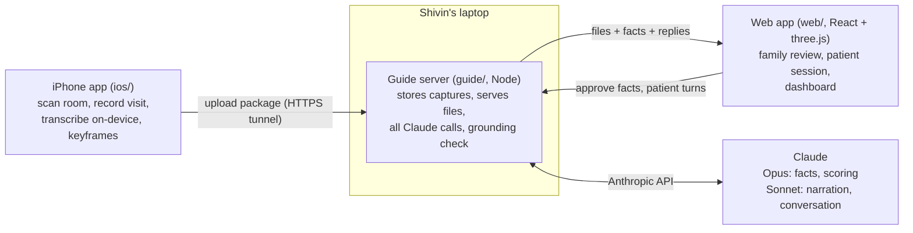

# Braindance: build plan for Claude Code

Working name: **Braindance**. Cal Hacks 13.0, submission deadline **Sunday Oct 25, 9:00 AM PT** (hard; aim for 8:30). Primary track: Anthropic "Claude for Public Benefit". Secondary: Cal Hacks People-First Social Impact, Meta "Bringing People Closer Together", Most Technically Advanced.

**If you're a new Claude Code session:** read this whole file, then `TASKS.md` to find your owner's slice, then the **Status** section at the bottom for where things stand. Don't ask the person to re-explain the project. Before you stop, update Status and the Work log (see "Handoff protocol").

> **Plan v2 (Sat 07:00):** the Python pipeline on the ASUS GX10 is gone. A small Node "guide server" (`guide/`, modeled on the Déjà View guide) stores captures and makes every Claude call. The phone does its own transcription and keyframes. Two builders own the product: **Shivin** (phone + guide server) and **Firdavs** (web). Old references to `server/`, Python, Whisper, SQLite or the GX10 are obsolete.

---

## 0. Ground rules

1. **Hackathon rule: all work happens during the event.** The `IBS27/rumi` repo (HackMIT 2026) and Shivin's Déjà View project are references for which APIs work and how a guide server was shaped. Don't copy files or code blocks from either; write every line fresh. Credit both in the Devpost as prior reference.
2. **Nothing fake.** Never show mock or sample data in the UI as if it came from a real capture or a real patient session. Mock mode (`MOCK_CLAUDE=1`) prefixes every output with `[mock]`, and the web shows a red MOCK MODE banner. If a step fails, the UI shows the failure.
3. **Grounded or nothing.** Claude never says anything to the person with dementia that the recording doesn't support. Code enforces this (Section 6.4).
4. **Ship the loop first.** One real capture must go phone → guide → family review → patient session → dashboard before anyone polishes anything.

---

## 1. What we're building

A family member films a visit with a LiDAR iPhone. Braindance turns the recording into a moment the person with dementia can step back into over the following days. Claude narrates it gently, talks with them about it, and measures which details they hold onto. The family sees recall over time and any older memories the moment brought up.

**Named community:** families who visit a parent with mild-to-moderate Alzheimer's living in memory care.

**Why no photoreal reconstruction:** we don't need a Gaussian splat. We need the *moment*: the room, the people moving in it, what they said. So we capture synchronized **video + audio + LiDAR depth + camera poses**, build the room as a colored point cloud on the phone, and replay the people in 3D from per-frame depth. That's cheaper, more honest, and looks like the Cyberpunk braindance editor.

### Demo script (3 minutes)
1. Hook: "The morning after the whole family came for her birthday, she asked when someone would visit."
2. The iPhone app: scan the room (points light up live), then record a short visit.
3. Family view: Claude extracted the moment's facts, each linked to the exact frame or quote. The family approves them, and marks one "don't bring this up."
4. Patient view on a tablet: the room appears, people replay in 3D, and Claude narrates ("This is Sunday. Priya brought the mango cake you love.").
5. "Grandma" says "this kitchen looks like my mother's." Claude invites the story and logs a branch.
6. Show the grounding log: a sentence Claude tried to say that wasn't backed by an approved fact, dropped by code.
7. Dashboard: recall across the sessions we actually ran this weekend, plus the branch.
8. Close: research basis (SenseCam / Woodberry 2015) and the pilot plan.

---

## 2. Architecture



| Piece | Where | Owner | Contract |
|---|---|---|---|
| iPhone capture app | `ios/` | Shivin | writes `docs/capture-format.md` |
| Guide server | `guide/` | Shivin | serves `docs/guide-api.md` |
| Web app | `web/` (served by the guide at `/`) | Firdavs (viewer started by Shivin) | reads both docs |

The two docs in `docs/` are the contracts. If you need a change, say so in the team chat; the owner changes the doc first, then the code.

Networking: the guide runs on Shivin's laptop and is exposed with `cloudflared tunnel --url http://127.0.0.1:8787`, since venue Wi-Fi blocks device-to-device traffic. The phone and the tablet both use that HTTPS URL. AirDrop of the capture zip is the fallback.

---

## 3. iPhone app (Shivin)

Plan: `IOS_CAPTURE_PLAN.md` (checkpoints 1–5 are built and tested on the phone). Remaining work is in `TASKS.md`. Summary of what it does:

- One continuous ARKit session: **room scan** (live GPU point cloud, 1 cm export to `room.bin`/`room.ply`), then **moment recording** (video + audio, a pose per frame, depth at 10 Hz) without resetting, so the moment lines up with the room.
- After recording: **on-device transcription** (Apple Speech framework, word timestamps) and **keyframes** (one per second), then a **review screen** (title, who was there) and **upload** to the guide.

Build and run: `ios/README.md`. Project from `ios/project.yml` via XcodeGen. Unit tests: `xcodebuild test` on any iPhone simulator (25 tests pass).

---

## 4. Capture package

Full spec: **`docs/capture-format.md`**. Short version: `manifest.json`, `room.bin` (UInt32 N, N×xyz float32, N×rgb uint8), `video`, `frames.jsonl` (column-major camera-to-world `T`, intrinsics `K`, depth index `d`, negative `t` during the scan), `depth.bin` (UInt16 mm, 256×192, 10 Hz), `confidence.bin`, `thumb.jpg`, and soon `transcript.json` and `keyframes/`.

A real sample capture is on the GitHub release `sample-capture-1`.

---

## 5. Guide server (Shivin)

Full API: **`docs/guide-api.md`**. Node 20+, plain `node:http` (no framework), `@anthropic-ai/sdk`, files on disk instead of a database. Layout:

```
guide/
  package.json            "start": "node src/server.mjs", "test": "node --test"
  .env.example
  src/server.mjs          routing, CORS, auth header, static files with Range
  src/store.mjs           captures, moment.json, sessions on disk
  src/validate.mjs        package checks on /complete (sizes match the manifest)
  src/claude.mjs          one place that calls the Anthropic API; MOCK_CLAUDE switch
  src/prompts.mjs         every prompt, in one file
  src/facts.mjs           fact extraction (6.2)
  src/session.mjs         narration, turns, distress, branches (6.5)
  src/scoring.mjs         recall scoring (6.6)
  src/grounding.mjs       the grounding check (6.4)
  test/*.test.mjs         node:test with a stubbed Claude client: no network, no key
  data/                   gitignored
```

Every Claude call uses **tool use with a JSON schema** for structured output and validates the result before using it. Model names come from `.env`.

---

## 6. Claude integration

### 6.1 Roles
1. **Fact extractor:** turns the recording into small, true, checkable details.
2. **Grounded narrator:** describes the moment using only approved facts.
3. **Errorless companion:** talks with the person, offers information instead of quizzing, follows their lead.
4. **Recall scorer:** after each session, judges which facts the person brought up and how.
5. **Branch catcher:** notices when the person connects the moment to an older memory.
6. **Distress check:** notices confusion or grief and ends gently.

### 6.2 Fact extraction (Opus, once per capture)
Input: up to 30 keyframes (evenly spaced, plus any near speech) as images, the transcript with timestamps, and the manifest's title and attendees. Output (tool `record_facts`):
```json
{
  "moment": { "title": "", "place": "", "occasion": "", "summary": "" },
  "facts": [{
    "id": "f1",
    "text": "Priya brought a mango cake.",
    "kind": "person|object|action|speech|place|feeling",
    "salience": 1,
    "evidence": [{ "type": "frame", "t": 12, "keyframe": "keyframes/k0012.jpg" },
                 { "type": "transcript", "tStart": 12.4, "tEnd": 15.0, "quote": "I brought the mango cake" }],
    "cue": "There was cake on the table."
  }],
  "chapters": [{ "tStart": 0, "tEnd": 20, "label": "Arriving" }]
}
```
Prompt rules: only state what the frames or transcript show; use the attendee names the family typed and never guess identities from faces; one short sentence per fact; mark feelings only when someone said them out loud. Aim for 8–20 facts. Every fact needs at least one piece of evidence, or it's discarded in code.

### 6.3 Family review
Nothing reaches the patient until a family member approves it. The review screen shows each fact next to its evidence (the keyframe, or the quote with a play button that seeks the video). The family can approve, edit the wording, or reject. They can also mark a fact "don't bring this up" (for example, someone who has since died).

### 6.4 Grounding enforcement (code, not prompt)
Every narrator and companion reply comes back as structured JSON, `[{ "sentence": "...", "factIds": ["f1"], "free": false }]`. `guide/src/grounding.mjs` drops any sentence citing an unknown, unapproved or do-not-raise fact; holds sentences citing nothing to the free-sentence rules (no number, date, place, relationship word or name, except words the person just said and their form of address); allows one free sentence per reply, two after distress or a shared memory; and logs every dropped sentence with a reason. Full rules in `docs/guide-api.md`.

### 6.5 Companion system prompt (core of it)
- You're talking with someone who has dementia, about a moment their family shared with them.
- Speak in short, warm sentences. One idea at a time.
- **Never** ask "do you remember...?" and never test. Offer the detail yourself, then leave room: "Priya brought the mango cake you love. It looked delicious."
- Follow their lead. If they talk about something else, go with them.
- If they connect this to an older memory, show interest and ask one gentle open question ("What was your mother's kitchen like?"). Put their words in the reply's `branch` field.
- If they seem confused, upset or frightened, stop the moment, reassure them in plain words, and set `distress`. Don't correct them or argue.
- Never mention facts the family marked "don't bring up."
- Only use the approved facts provided. Never invent details.

### 6.6 Scoring (Opus, after each session)
Input: approved facts, the full session log with timestamps, and which facts Claude had already said before each patient utterance. Output per fact: `unprompted` (they said it before Claude mentioned it), `after_cue` (they repeated or extended it after Claude mentioned it), `not_mentioned`. Plus `branches[]` and a short neutral session note for the family. Never show the patient a score.

---

## 7. Web app (Firdavs)

Vite + React + TypeScript + React Three Fiber + drei, in `web/`. It talks only to the guide server (`VITE_GUIDE_URL`). Two audiences, two visual languages:
- **Family views:** dark, precise Braindance-style editor.
- **Patient view (Revisit):** calm, high contrast, large type, one big button, no clutter, works on a tablet in landscape.

### 7.1 Captures list
Every capture from `GET /api/captures` with its thumbnail and real pipeline status (facts queued / running / done / failed with the message).

### 7.2 Scene viewer (shared component)
- **StaticCloud:** loads `room.bin`, renders round soft points (custom shader, size attenuation). Shows the recorder's path from `frames.jsonl` as a faint line.
- **Fallback first (an hour's work):** the video in a panel, synced to a playhead moving along the camera path in the cloud.
- **DepthReplay (the Braindance effect):** the video as a `VideoTexture` plus a 256×192 grid of points. Each frame, find the depth frame nearest `video.currentTime`, upload it as a `Uint16` data texture, and unproject in the vertex shader with the math in `docs/capture-format.md`, using that frame's `T` and `K`. Points take their color from the video. People appear in 3D, in place, in sync with sound. Fetch `depth.bin` in chunks with range requests.
- **CameraPath mode** (camera follows the recorded pose, smoothed) and **Free mode** (orbit).
- Areas without data stay empty. Never fill them.

### 7.3 Family: fact review
Timeline under the viewer with chapters; fact list on the side; clicking a fact jumps the viewer to its evidence time. Approve, edit, reject, "don't bring up". A "Re-extract" button calls `/extract`.

### 7.4 Patient: Revisit session
State machine: `welcome → replay → conversation → goodbye`.
- **Welcome:** "Hello, Mom. Let's look at Sunday together." (address from `people.json`).
- **Replay:** CameraPath mode at 0.75× speed. At each chapter, `/narrate` returns two or three grounded sentences, spoken with `speechSynthesis`.
- **Conversation:** one huge "Talk" button (push to talk) using the browser's speech recognition (`webkitSpeechRecognition` works in Safari on iPad). The text goes to `/turn` and the reply is spoken. A text box behind a caregiver toggle is the fallback.
- **Goodbye:** short, warm close. The session ends after 10 minutes, on distress, or from the caregiver's corner button.

### 7.5 Family: dashboard
- Per moment: a chart of facts recalled unprompted and after a cue, one point per session, with the real session time on the x-axis. Never relabel a 2-hour gap as "day 3."
- Branches list ("This kitchen looks like my mother's").
- Distress alerts and session notes.
- Next suggested revisits: +1, +3, +7, +14 days after the visit.

---

## 8. Impact measurement (say this in the pitch, build the instrument)

- **Primary:** details recalled per moment across spaced sessions, split into unprompted versus after a cue. This mirrors the SenseCam protocol (Woodberry et al., 2015).
- **Secondary:** branch count per moment; session length; distress rate.
- **Pilot plan:** one memory care facility, the same visit reviewed with Braindance versus a written diary, recall tested at 2 weeks and 3 months.
- **Honesty:** a hackathon can't prove impact. The demo shows real sessions run this weekend, labeled with their real times.

## 9. Safety and dignity

- Family approval gates everything the patient sees or hears.
- "Don't bring up" respects grief; Claude never mentions those facts.
- No face recognition. Names come from the family.
- Distress ends the session gently and alerts the family.
- Transcription runs on the phone; captures stay on the team's laptop for the hackathon. Say so.
- Get consent from everyone filmed.

## 10. Timeline (Sat 07:00 onward)

| By | Milestone |
|---|---|
| 07:00–11:00 | Team rests. Shivin works alone (TASKS.md "Right now") |
| 11:00 | Guide server serves the sample capture and its files; web scaffold starts |
| 13:00 | Phone writes transcript + keyframes, uploads to the guide; web shows the room cloud + synced video |
| 16:00 | Fact extraction on a real capture; family review screen works end to end |
| 18:00 | Grounding check with tests; sessions (narrate, turn, end) work from the web |
| 20:00 | **Film the demo visit** (brother's house) with a stand-in grandparent; consent from everyone filmed |
| 22:00 | Revisit session end to end on the tablet: narration, push-to-talk, companion, speech |
| 01:00 | Scoring + dashboard; DepthReplay if not done |
| 01:00–04:00 | Run 3+ real revisit sessions spaced a few hours apart; fix bugs |
| 04:00–07:30 | Demo video, Devpost, screenshots, README |
| 07:30–08:30 | Rehearse the 3-minute pitch twice |
| **08:30** | **Submit** (hard deadline 09:00) |

## 11. Cut list (drop in this order if behind)

1. DepthReplay shader (keep the synced video fallback)
2. Branch photos
3. Cartesia voice (browser speech instead; already the default)
4. Push-to-talk speech recognition (caregiver types what the patient said)
5. Phone upload (AirDrop the zip; the guide imports a folder)

Never cut: real capture, grounded facts with family approval, grounding enforcement, recall scoring, dashboard chart.

## 12. Acceptance checklist (before recording the demo video)

- [ ] A fresh iPhone capture goes from record to approved facts with no manual file moves.
- [ ] Clap test passes (audio within ±1 frame of the hands meeting).
- [ ] Grounding test: an injected ungrounded sentence gets dropped and logged.
- [ ] A rejected or "don't bring up" fact never appears in narration across 5 sessions.
- [ ] Distress phrase ("I want to go home, where is everyone") ends the session and creates an alert.
- [ ] Dashboard chart shows real session timestamps.
- [ ] Revisit view works on a tablet in landscape with large touch targets.
- [ ] README explains setup, the capture format and the research basis, and credits Rumi and Déjà View as references.

## 13. How Claude Code should work on this

1. Read the contracts in `docs/` before writing code that touches files or APIs. Don't change a contract silently.
2. Keep pure logic (parsing, math, grounding, validation) in small functions with tests that run without network or keys.
3. Swift: no third-party dependencies; list anything that needs the physical phone in `ios/VERIFY.md`.
4. Put API keys in `guide/.env`, never in `web/` or `ios/`.
5. When something can't work (missing key, failed step), show a clear error. Don't substitute sample data.
6. Commit small and often on a branch named for your area (`ios/...`, `guide/...`, `web/...`), push it, and open a PR. Never push to `main` directly. Write commit messages as the person you're working for; add no AI attribution lines.

## References for the README

- Woodberry et al. (2015), *Memory*, wearable camera and autobiographical memory in Alzheimer's: https://www.microsoft.com/en-us/research/?p=464112
- Woods et al. (2018), Cochrane review, reminiscence therapy for dementia: https://pmc.ncbi.nlm.nih.gov/articles/PMC6494367
- Conway & Pleydell-Pearce (2000), the self-memory system: https://pubmed.ncbi.nlm.nih.gov/10789197/
- Spaced retrieval in Alzheimer's: https://www.termedia.pl/Spaced-retrieval-as-a-tool-to-work-with-patients-with-Alzheimer-s-disease,46,55467,1,1.html
- Apple sample code "Displaying a point cloud using scene depth" (pattern followed for the live cloud)

---

## Status

**Last updated:** Sat Oct 24, 16:30 PT, by Shivin's Claude session. **What's left, who does it and the timeline: the top of `TASKS.md` ("Everything left until submission").** The final feature's plan: `docs/LAST-STEP.md`. Sponsor plan: `docs/SPONSOR-PLAN.md`. Theme: `docs/THEME.md` (public name **Relive With A Smile**; "Braindance" stays the internal code name).

**Done and working** (checked on real hardware or real Claude):
- **iPhone app** (`ios/`): live room scan, visit recording, on-device transcript, keyframes, review, upload, AirDrop zip, guided UI (#21 merged, tried on the phone).
- **Guide server** (`guide/`): uploads, fact extraction, review, revisit sessions, grounding, distress, scoring, progress, read-only `/public` routes and the static exporter (in #17/#25).
- **Website** (`web/`): Firdavs's viewer on `main` (#13). **PR #25** (`web/orange`) holds the current site: one orange look, **no password anywhere**, the public front page (#17) and the **Memory Window** (#23, head-tracked 3D on any screen).
- **Old video → 3D** (`tools/video-to-3d`, `tools/video2capture/`): Depth Anything 3 on a Mac; three real clips converted, render in the viewer and the Memory Window (drag-to-look checked).
- **Data for the team:** private release `team-data-1` (Shivin's four phone scans with approved facts, the three converted clips, the source clips). How to use it: `docs/LAST-STEP.md`.
- **Public site:** https://shividoge.github.io/braindance-site/ (four real scans; a snapshot from before #25, republish after the web stack merges).
- **Security:** the Anthropic key that was committed in `guide/.env.example` is deleted in the Console (rejected with 401) and blanked on `main` (#30); a new key is in Shivin's `guide/.env`.

**In progress (branches pushed, PRs to open):**
- `web/video-estimated`: "Estimated from a video, not measured" badge everywhere a video-made scene shows.
- `web/museum`: the **Memory Museum** (`#/museum`), picture frames per moment that open the Memory Window; UI works, **the 3D hall draws nothing** (Firdavs, M1).
- `web/museum-together` (to create): a family member joins the museum from their phone (IBS27, M3).
- `web/hide-triggers`: "Hide from her" (guide side done, web side paused).
- PR #16 (Firdavs, render quality) needs to go on top of #25. PR #24 (IBS27, plan v3) waits for Shivin.

**Next:** follow the Must list in `TASKS.md`. Demo visit filming at 20:00; real Revisit sessions 01:00–04:00; submit by 08:30.

### Local machine notes (Shivin's MacBook Air)

- **Repo:** `~/Developer/braindance` (GitHub `shividoge/braindance`, private). Teammates: `boliyevfirdavs` (Firdavs, web; accepted), `IBS27` (accepted).
- **Run the guide + website:** `npm --prefix guide start` from the repo root → http://127.0.0.1:8787. After changing `web/`, run `npm --prefix web run build` (the guide serves `web/dist`). Dev with hot reload: `npm --prefix web run dev` (port 5173, proxies to the guide).
- **Secrets:** `guide/.env` (gitignored) holds `ANTHROPIC_API_KEY` (Shivin's Claude Console credits, verified working) and `BRAINDANCE_KEY` (empty since #25: no password anywhere). Never print, commit or paste either.
- **Who the sessions are for:** `guide/data/people.json` = `{"displayName": "Grandma", "preferredAddress": "Mom"}` (placeholder; change with `PUT /api/person`).
- **Public URL for judges** (Shivin runs this himself; Claude Code is blocked from opening tunnels): `cloudflared tunnel --url http://127.0.0.1:8787`, then share the printed `https://….trycloudflare.com` URL (no password needed). The URL changes every restart.
- **iPhone builds:** Xcode 27.1 at `/Applications/Xcode.app`. Phone UDID `00008140-001825992212801C`, signing team `AK3HPCD97G` (free Personal Team, set in `ios/project.yml`; installs expire after 7 days, so reinstall then). Build + install + launch with the phone plugged in and unlocked:
  ```bash
  cd ios && xcodegen generate
  xcodebuild -project BraindanceCapture.xcodeproj -scheme BraindanceCapture -destination 'id=00008140-001825992212801C' -derivedDataPath /tmp/bd-device -allowProvisioningUpdates build
  xcrun devicectl device install app --device 00008140-001825992212801C /tmp/bd-device/Build/Products/Debug-iphoneos/BraindanceCapture.app
  xcrun devicectl device process launch --device 00008140-001825992212801C com.shividoge.braindance.capture
  ```
  Unit tests: `xcodebuild test` with any iPhone simulator destination.
- **Getting captures off the phone:** review screen → "AirDrop the capture (zip)" → drop the zip on the website (or `npm --prefix guide run import -- <unzipped folder>`).
- **Gotchas:** the in-app browser preview tool reads `~/.claude/launch.json` (another project), not the repo's, so run the guide in a terminal instead. Mac-made zips contain `._` files; the website skips them. `~/Downloads/CLAUDE.md` belongs to a different project (Echo Sight); ignore it.
- **Commits:** credited to Shivin only, no AI attribution lines in commits or PRs. Work on a branch, open a PR, and merge only when Shivin says so. Never push to `main` directly.
- **Test data hygiene:** if you run test sessions or test review clicks against real captures, undo them afterwards (delete the session file in `guide/data/sessions/`, reset the facts) so nothing fake reaches the dashboard.

## Work log

Append one line per work chunk, newest last: `date time | who | what changed | what's next`.

- 2026-10-24 05:40 | Shivin + Claude | repo created, plan v1 committed | iOS checkpoint 1
- 2026-10-24 06:45 | Shivin + Claude | iOS checkpoints 1–5 built, installed, two real captures verified; fixed 60 fps / 12 Hz depth bug | send room.bin to Firdavs, capture to guide
- 2026-10-24 07:15 | Shivin + Claude | plan v2: dropped the GX10 pipeline for a Node guide server; wrote contracts and TASKS | guide server, web scaffold
- 2026-10-24 07:30 | Shivin + Claude | guide server step 1 (uploads, validation, Range, import) | phone step 2, guide step 3
- 2026-10-24 ~07:45 | Shivin + Claude | phone step 2 (transcript, keyframes, review, upload); web viewer with people replay, served by the guide | guide step 3
- 2026-10-24 ~07:55 | Shivin + Claude | guide step 3: Claude fact extraction with grounding; real run OK | review screen
- 2026-10-24 ~08:00 | Shivin + Claude | family fact review panel in the viewer | guide step 4
- 2026-10-24 08:15 | Shivin + Claude | guide step 4: sessions, reply grounding, distress, scoring, progress; fixes from a real Claude run (PR #8) | merge PR #8; sign scan diagnosis; Revisit screen + dashboard
- 2026-10-24 08:20 | Shivin + Claude | handoff written: Shivin switching Claude accounts | next session starts at "Next steps" above
- 2026-10-24 ~13:00 | Shivin + Claude | PR #8 merged; Revisit screen + dashboard (#9); public site, static export and GitHub Pages (#11, #12, #14); iOS medium-confidence option (#10); four real scans published | decide the web/ tree with Firdavs's #13; tonight's demo capture
- 2026-10-24 ~19:00 | Shivin + Claude | Firdavs's web/ merged (#13); public site ported onto it (#17); briefs for render quality, photo-to-3D and sponsors; guided phone UI merged (#21) | review #17 and #16; demo capture 20:00; sponsor work
- 2026-10-24 16:00 | Shivin + Claude | pushed web/museum (WIP) and tools/video-to-3d; handed all remaining work to Firdavs and IBS27 for two hours (TASKS.md "Right now") | Firdavs: #25 + #16, museum; IBS27: video-to-3D, Devpost
- 2026-10-24 16:20 | Shivin + Claude | video2capture fixed and run on three real clips (render in viewer + Memory Window); data release team-data-1; docs/LAST-STEP.md with the shared-museum spec | Firdavs: museum canvas + iPad; IBS27: Visit together
- 2026-10-24 16:30 | Shivin + Claude | one master list of everything left until submission (TASKS.md top), Status rewritten, data release team-data-1 | team follows the Must list
- 2026-10-24 16:40 | IBS27 + Claude | PRs open (not merged): #39 Visit together (on web/museum; guide tests 75/75, needs iPad+phone test via tunnel), #37 video2capture on Linux/CUDA (matches Mac output on 3 clips), #35 Devpost draft, #36 demo video plan, #38 sponsor rules checked (repo must be public for judging; all three checked in by 08:00), #34 filming prep | IBS27: fill filming-prep blanks before 20:00, two-device test of #39 after Firdavs's museum fix, M5 when Shivin sends the old video

---

## Handoff protocol

**For Claude (every session):**
1. On start: read this file, `TASKS.md`, and the contract docs; check `git log` and open PRs to confirm Status matches reality.
2. While working: keep changes small; commit after each working piece on your branch.
3. Before stopping, or whenever context or credits run low: update **Status** and append to the **Work log**, then commit and push. Write the next step so concretely that a fresh session could start it with no questions.
4. Never delete a decision from this file; if a person changes one, edit it and note the change in the Work log.

**For people:** open Claude Code in your clone of the repo and say: **"Read CLAUDE.md and TASKS.md. I'm <name>. Continue from my next step."**
