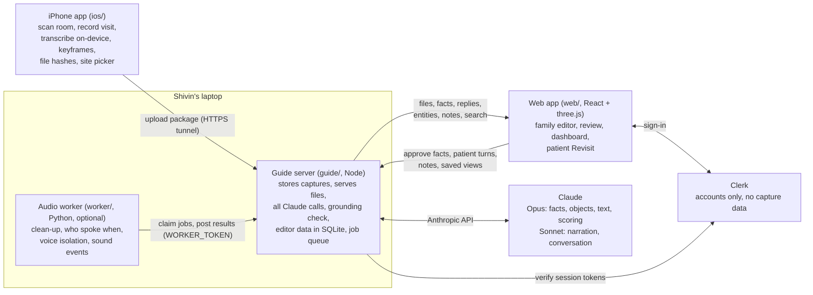

# Braindance: build plan for Claude Code

Working name: **Braindance**. Cal Hacks 13.0, submission deadline **Sunday Oct 25, 9:00 AM PT** (hard; aim for 8:30). Primary track: Anthropic "Claude for Public Benefit". Secondary: Cal Hacks People-First Social Impact, Meta "Bringing People Closer Together", Most Technically Advanced.

**If you're a new Claude Code session:** read this whole file, then `TASKS.md` to find your owner's slice, then the **Status** section at the bottom for where things stand. Don't ask the person to re-explain the project. Before you stop, update Status and the Work log (see "Handoff protocol").

> **Plan v2 (Sat 07:00):** the Python pipeline on the ASUS GX10 is gone. A small Node "guide server" (`guide/`, modeled on the Déjà View guide) stores captures and makes every Claude call. The phone does its own transcription and keyframes. Two builders own the product: **Shivin** (phone + guide server) and **Firdavs** (web). Old references to `server/`, Python, Whisper, SQLite or the GX10 are obsolete.

> **Plan v3 (Sat evening, proposal in an open docs PR; Shivin to review):** the family's side becomes a full spatial editor for the visit: saved objects, a layered timeline, inspecting details, focused audio, search, notes and share links, comparing visits, and tracing anything back to its frames and audio. The product, the named community, the patient's Revisit and every safety rule stay the same. New contract: **`docs/scene-model.md`**. New pieces: SQLite inside the guide (`node:sqlite`) for editor data, Clerk accounts, and an optional Python audio worker in `worker/`. This brings back SQLite and a little Python, which plan v2 had dropped (see the Work log); the GX10 stays gone.

---

## 0. Ground rules

1. **Hackathon rule: all work happens during the event.** The `IBS27/rumi` repo (HackMIT 2026) and Shivin's Déjà View project are references for which APIs work and how a guide server was shaped. Don't copy files or code blocks from either; write every line fresh. Credit both in the Devpost as prior reference.
2. **Nothing fake.** Never show mock or sample data in the UI as if it came from a real capture or a real patient session. Mock mode (`MOCK_CLAUDE=1`) prefixes every output with `[mock]`, and the web shows a red MOCK MODE banner. If a step fails, the UI shows the failure.
3. **Grounded or nothing.** Claude never says anything to the person with dementia that the recording doesn't support. Code enforces this (Section 6.4).
4. **Ship the loop first.** One real capture must go phone → guide → family review → patient session → dashboard before anyone polishes anything.

---

## 1. What we're building

A family member films a visit with a LiDAR iPhone. Braindance turns the recording into a moment the person with dementia can step back into over the following days. Claude narrates it gently, talks with them about it, and measures which details they hold onto. The family sees recall over time and any older memories the moment brought up.

**Named community:** families who visit a parent with mild-to-moderate Alzheimer's living in memory care.

**Why no photoreal reconstruction:** we don't need a Gaussian splat. We need the *moment*: the room, the people moving in it, what they said. So we capture synchronized **video + audio + LiDAR depth + camera poses**, build the room as a colored point cloud on the phone, and replay the people in 3D from per-frame depth. That's cheaper, more honest, and looks like the Cyberpunk braindance editor.

Public name: **Relive With A Smile** ("Relive" for short); see `docs/THEME.md`. Code and file formats keep `braindance`.

### The family's editor (plan v3)

The patient sees one calm, approved moment. The family (and care staff they invite) get a spatial editor for the same recording: a navigable 3D room with a synchronized timeline underneath. They use it to prepare the moment, answer questions they didn't think to ask during the visit, and share exactly what they mean with each other.

| Capability | What it means in Relive |
|---|---|
| Explore and replay | Move through the room, pause, rewind, change speed, jump back to where the phone was |
| Follow an object | Select the cake, the photo on the wall or Grandma's armchair and see every moment it's on camera, from each angle |
| Inspect a detail | Select a birthday card or a label: get its clearest frames, steadied and squared up, with the writing read out |
| Focus on audio | Jump through the transcript, see who spoke when, clean up noise or isolate Priya's voice; the original stays one click away |
| Spatial relationships | Distances, heights and paths in the room ("the walk from the bed to the door"), with "check this in person" when the numbers aren't solid |
| Find moments | Search "when did someone mention the garden", "the card", "laughter" |
| Annotate and collaborate | Pin notes, questions and findings to an object, a spot or a moment, and share a link that opens that exact view |
| Compare visits | Line up visits to the same room over weeks and see what changed |
| Trace to source | Every fact, label, read text and line Claude speaks opens the frames and audio it came from, and says how any enhanced view was made |

**What "enhance" means, and doesn't.** It makes better use of what was captured. It can't show a surface the phone never saw, recover a conversation nobody recorded, or rebuild something that happened before recording started. Moving people and objects appear only where the recording supports them. Every item is tagged as measured, computed, estimated by a model, or written by a person (`docs/scene-model.md`), and estimates look different on screen.

### Demo script (3 minutes)
1. Hook: "The morning after the whole family came for her birthday, she asked when someone would visit."
2. The iPhone app: scan the room (points light up live), then record a short visit.
3. Family view: Claude extracted the moment's facts, each linked to the exact frame or quote. The family approves them, and marks one "don't bring this up."
4. The editor: select the birthday card on the table. Relive pulls its clearest frame and reads the writing (tagged "estimated"). Pin a note to Grandma's armchair ("she sat here the whole time") and open its share link on a second laptop: same object, same moment, same view.
5. Patient view on a tablet: the room appears, people replay in 3D, and Claude narrates ("This is Sunday. Priya brought the mango cake you love.").
6. "Grandma" says "this kitchen looks like my mother's." Claude invites the story and logs a branch.
7. Show the grounding log: a sentence Claude tried to say that wasn't backed by an approved fact, dropped by code. Click a sentence that was spoken: it traces to its fact, and the fact to its frame.
8. Dashboard: recall across the sessions we actually ran this weekend, plus the branch.
9. Close: research basis (SenseCam / Woodberry 2015) and the pilot plan.

---

## 2. Architecture



| Piece | Where | Owner | Contract |
|---|---|---|---|
| iPhone capture app | `ios/` | Shivin | writes `docs/capture-format.md` |
| Guide server | `guide/` | Shivin | serves `docs/guide-api.md`, stores `docs/scene-model.md` |
| Web app | `web/` (served by the guide at `/`) | Firdavs (viewer started by Shivin) | reads all three docs |
| Audio worker (optional) | `worker/` | IBS27 (proposed) | the worker routes in `docs/guide-api.md`; writes `Artifact` and `SceneEvent` from `docs/scene-model.md` |

The three docs in `docs/` are the contracts: `capture-format.md` (the phone's files), `guide-api.md` (the guide's routes) and `scene-model.md` (the editor's shared data: entities, events, artifacts, notes, sites, saved views, provenance). If you need a change, say so in the team chat; the owner changes the doc first, then the code.

**Storage:** captures stay as files on disk, never modified after upload. `moment.json` and session files stay as they are. Editor data (`docs/scene-model.md`) goes in one SQLite file, `guide/data/braindance.db`, through Node's built-in `node:sqlite` (Node 22.13+), with full-text search in SQLite FTS5. Derived media goes in `guide/data/derived/<captureId>/`.

**Accounts:** Clerk handles sign-in for family members and invited care staff. Each site has roles: `owner` (invites people, deletes), `family` (edits, approves facts, writes notes) and `viewer` (sees and comments; for care staff). The phone and the patient's tablet use device tokens an owner creates, so the patient never logs in. `BRAINDANCE_KEY` keeps working as an admin key until Clerk lands. Clerk sees only accounts; captures and notes stay on the laptop.

**Jobs:** after upload the guide queues work per capture. Claude jobs: `facts`, `objects`, `text`, `events_visual`. Computed jobs (plain math on poses, depth and the room cloud): `appearances`, `best_views`, `rectify`, `stabilize`, `align`, `changes`. Audio jobs (`audio_clean`, `diarize`, `isolate`, `sound_events`) wait for the worker. If no worker is running they stay queued and the UI says so; nothing else depends on them.

Networking: the guide runs on Shivin's laptop and is exposed with `cloudflared tunnel --url http://127.0.0.1:8787`, since venue Wi-Fi blocks device-to-device traffic. The phone and the tablet both use that HTTPS URL. AirDrop of the capture zip is the fallback.

---

## 3. iPhone app (Shivin)

Plan: `IOS_CAPTURE_PLAN.md` (checkpoints 1–5 are built and tested on the phone). Remaining work is in `TASKS.md`. Summary of what it does:

- One continuous ARKit session: **room scan** (live GPU point cloud, 1 cm export to `room.bin`/`room.ply`), then **moment recording** (video + audio, a pose per frame, depth at 10 Hz) without resetting, so the moment lines up with the room.
- After recording: **on-device transcription** (Apple Speech framework, word timestamps) and **keyframes** (one per second), then a **review screen** (title, who was there) and **upload** to the guide.

Build and run: `ios/README.md`. Project from `ios/project.yml` via XcodeGen. Unit tests: `xcodebuild test` on any iPhone simulator (25 tests pass).

---

## 4. Capture package

Full spec: **`docs/capture-format.md`**. Short version: `manifest.json`, `room.bin` (UInt32 N, N×xyz float32, N×rgb uint8), `video`, `frames.jsonl` (column-major camera-to-world `T`, intrinsics `K`, depth index `d`, negative `t` during the scan), `depth.bin` (UInt16 mm, 256×192, 10 Hz), `confidence.bin`, `thumb.jpg`, `transcript.json` and `keyframes/`. Plan v3 adds an optional `site` and per-file SHA-256 `hashes` to the manifest.

A real sample capture is on the GitHub release `sample-capture-1`.

---

## 5. Guide server (Shivin)

Full API: **`docs/guide-api.md`**. Node 22.13+ (for `node:sqlite`), plain `node:http` (no framework), `@anthropic-ai/sdk`. Captures, moments and sessions are files on disk; editor data is in SQLite (Section 2). Layout (modules marked *planned* are plan v3):

```
guide/
  package.json            "start": "node src/server.mjs", "test": "node --test"
  .env.example
  src/server.mjs          routing, CORS, auth header, static files with Range
  src/store.mjs           captures, moment.json, sessions on disk
  src/validate.mjs        package checks on /complete (sizes match the manifest)
  src/claude.mjs          one place that calls the Anthropic API; MOCK_CLAUDE switch
  src/prompts.mjs         every prompt, in one file
  src/facts.mjs           fact extraction (6.2)
  src/session.mjs         narration, turns, distress, branches (6.5)
  src/scoring.mjs         recall scoring (6.6)
  src/grounding.mjs       the grounding check (6.4)
  src/db.mjs              planned: node:sqlite connection, schema and migrations for docs/scene-model.md
  src/auth.mjs            planned: Clerk token check, site roles, device tokens, admin key
  src/jobs.mjs            planned: job queue (queued/running/done/failed), one runner per kind, worker claim/result
  src/entities.mjs        planned: entities, appearances, read text; save from a selection; merge
  src/lift.mjs            planned: 2D box on a keyframe → 3D bounds with that frame's depth and pose (pure math)
  src/vision.mjs          planned: Claude objects, text and visual events from keyframes and crops (6.7)
  src/views.mjs           planned: best views, rectify, stabilize (computed artifacts)
  src/measure.mjs         planned: distances and uncertainty (pure math)
  src/sites.mjs           planned: sites, alignment (yaw + shift ICP), changes between aligned captures
  src/notes.mjs           planned: notes, replies, saved views
  src/search.mjs          planned: FTS5 index over transcript, labels, read text, facts, events, notes
  src/provenance.mjs      planned: build and check Provenance records; trace walks
  test/*.test.mjs         node:test with a stubbed Claude client: no network, no key
  data/                   gitignored (captures/, sessions/, derived/, braindance.db)
worker/                   planned, optional: Python audio worker (uv), see 6.8
```

Every Claude call uses **tool use with a JSON schema** for structured output and validates the result before using it. Model names come from `.env`.

---

## 6. Claude integration

### 6.1 Roles
1. **Fact extractor:** turns the recording into small, true, checkable details.
2. **Grounded narrator:** describes the moment using only approved facts.
3. **Errorless companion:** talks with the person, offers information instead of quizzing, follows their lead.
4. **Recall scorer:** after each session, judges which facts the person brought up and how.
5. **Branch catcher:** notices when the person connects the moment to an older memory.
6. **Distress check:** notices confusion or grief and ends gently.
7. **Scene reader (plan v3):** names objects, reads visible writing and spots visual events, for the family's editor only (6.7).

### 6.2 Fact extraction (Opus, once per capture)
Input: up to 30 keyframes (evenly spaced, plus any near speech) as images, the transcript with timestamps, and the manifest's title and attendees. Output (tool `record_facts`):
```json
{
  "moment": { "title": "", "place": "", "occasion": "", "summary": "" },
  "facts": [{
    "id": "f1",
    "text": "Priya brought a mango cake.",
    "kind": "person|object|action|speech|place|feeling",
    "salience": 1,
    "evidence": [{ "type": "frame", "t": 12, "keyframe": "keyframes/k0012.jpg" },
                 { "type": "transcript", "tStart": 12.4, "tEnd": 15.0, "quote": "I brought the mango cake" }],
    "cue": "There was cake on the table."
  }],
  "chapters": [{ "tStart": 0, "tEnd": 20, "label": "Arriving" }]
}
```
Prompt rules: only state what the frames or transcript show; use the attendee names the family typed and never guess identities from faces; one short sentence per fact; mark feelings only when someone said them out loud. Aim for 8–20 facts. Every fact needs at least one piece of evidence, or it's discarded in code.

Plan v3: evidence items are `SourceRef`s from `docs/scene-model.md`, so a fact can also point at a region of a frame or a stretch of audio, and facts gain `entityIds` (the cake, the card) once the objects job has run. Old `moment.json` files stay valid: `frame` and `transcript` evidence are a subset of `SourceRef`.

### 6.3 Family review
Nothing reaches the patient until a family member approves it. The review screen shows each fact next to its evidence (the keyframe, or the quote with a play button that seeks the video). The family can approve, edit the wording, or reject. They can also mark a fact "don't bring this up" (for example, someone who has since died).

### 6.4 Grounding enforcement (code, not prompt)
Every narrator and companion reply comes back as structured JSON, `[{ "sentence": "...", "factIds": ["f1"], "free": false }]`. `guide/src/grounding.mjs` drops any sentence citing an unknown, unapproved or do-not-raise fact; holds sentences citing nothing to the free-sentence rules (no number, date, place, relationship word or name, except words the person just said and their form of address); allows one free sentence per reply, two after distress or a shared memory; and logs every dropped sentence with a reason. Full rules in `docs/guide-api.md`.

### 6.5 Companion system prompt (core of it)
- You're talking with someone who has dementia, about a moment their family shared with them.
- Speak in short, warm sentences. One idea at a time.
- **Never** ask "do you remember...?" and never test. Offer the detail yourself, then leave room: "Priya brought the mango cake you love. It looked delicious."
- Follow their lead. If they talk about something else, go with them.
- If they connect this to an older memory, show interest and ask one gentle open question ("What was your mother's kitchen like?"). Put their words in the reply's `branch` field.
- If they seem confused, upset or frightened, stop the moment, reassure them in plain words, and set `distress`. Don't correct them or argue.
- Never mention facts the family marked "don't bring up."
- Only use the approved facts provided. Never invent details.

### 6.6 Scoring (Opus, after each session)
Input: approved facts, the full session log with timestamps, and which facts Claude had already said before each patient utterance. Output per fact: `unprompted` (they said it before Claude mentioned it), `after_cue` (they repeated or extended it after Claude mentioned it), `not_mentioned`. Plus `branches[]` and a short neutral session note for the family. Never show the patient a score.

### 6.7 Scene reading for the editor (Opus, per capture and on demand; plan v3)
Three jobs, all for the family's editor. None of their output reaches the patient unless a family member turns it into an approved fact.
- **`objects`:** keyframes in, objects out: `{ label, box, t }` per frame (box normalized to the stored image). The guide lifts each box into 3D with the nearest depth frame and that frame's pose (`src/lift.mjs`, pure math), then merges it with an existing entity or creates one. Labels are `estimated`; people are labeled "person" unless the family typed a name. Never guess identities from faces.
- **`text`:** for a selected entity or region, the guide picks its clearest frames (`best_views`), squares them up when the surface is flat (`rectify`), crops them, and asks Claude to read the writing. Output `ReadText` with the crop as its source. Claude says "unreadable" rather than guess; partial reads mark the unclear part `[?]`.
- **`events_visual`:** keyframe sequences in, candidate events out ("Priya hands over the cake", "door opens"), each with a time range and the frames it rests on.

**Editor grounding (code, not prompt).** Every claim Claude makes in the editor (a label, a read, an event, a summary, an answer to a search) must cite at least one `SourceRef` Claude was actually shown. `src/provenance.mjs` drops anything that cites nothing, cites a frame or crop that wasn't in the request, or quotes words that aren't in the transcript, and logs it with a reason, the same way 6.4 does for patient replies. The patient-facing rules in 6.4 don't change.

### 6.8 Audio worker (optional; plan v3)
A small Python service in `worker/` (managed with `uv`) on the same laptop. It claims audio jobs from the guide over HTTP with `WORKER_TOKEN`, works on the capture's audio, and posts back `Artifact` files and `SceneEvent`s, each with `Provenance` (all `estimated`):
- `audio_clean`: noise reduction with DeepFilterNet3.
- `diarize`: who spoke when with pyannote 3.1. Labels are `S1`, `S2`…; the family maps them to names.
- `isolate`: one speaker's voice with SepFormer, guided by the diarization.
- `sound_events`: laughter, applause, a door, a knock, music, with PANNs CNN14.

Audio never leaves the laptop. The original track is always kept and offered next to any cleaned-up one. If the worker isn't running, audio jobs wait and the editor says so.

---

## 7. Web app (Firdavs)

Vite + React + TypeScript + React Three Fiber + drei, in `web/`. It talks only to the guide server (`VITE_GUIDE_URL`). Two audiences, two visual languages:
- **Family views:** dark, precise editor in the Relive palette (`docs/THEME.md`): restrained color, one hue per timeline layer.
- **Patient view (Revisit):** calm, high contrast, large type, one big button, no clutter, works on a tablet in landscape. Plan v3 doesn't change it.

### 7.1 Captures list
Every capture from `GET /api/captures` with its thumbnail and real pipeline status (facts queued / running / done / failed with the message).

### 7.2 Scene viewer (shared component)
- **StaticCloud:** loads `room.bin`, renders round soft points (custom shader, size attenuation). Shows the recorder's path from `frames.jsonl` as a faint line.
- **Fallback first (an hour's work):** the video in a panel, synced to a playhead moving along the camera path in the cloud.
- **DepthReplay (the Braindance effect):** the video as a `VideoTexture` plus a 256×192 grid of points. Each frame, find the depth frame nearest `video.currentTime`, upload it as a `Uint16` data texture, and unproject in the vertex shader with the math in `docs/capture-format.md`, using that frame's `T` and `K`. Points take their color from the video. People appear in 3D, in place, in sync with sound. Fetch `depth.bin` in chunks with range requests.
- **CameraPath mode** (camera follows the recorded pose, smoothed) and **Free mode** (orbit).
- Areas without data stay empty. Never fill them.

### 7.3 Family: fact review
Timeline under the viewer with chapters; fact list on the side; clicking a fact jumps the viewer to its evidence time. Approve, edit, reject, "don't bring up". A "Re-extract" button calls `/extract`.

### 7.4 Patient: Revisit session
State machine: `welcome → replay → conversation → goodbye`.
- **Welcome:** "Hello, Mom. Let's look at Sunday together." (address from `people.json`).
- **Replay:** CameraPath mode at 0.75× speed. At each chapter, `/narrate` returns two or three grounded sentences, spoken with `speechSynthesis`.
- **Conversation:** one huge "Talk" button (push to talk) using the browser's speech recognition (`webkitSpeechRecognition` works in Safari on iPad). The text goes to `/turn` and the reply is spoken. A text box behind a caregiver toggle is the fallback.
- **Goodbye:** short, warm close. The session ends after 10 minutes, on distress, or from the caregiver's corner button.

### 7.5 Family: dashboard
- Per moment: a chart of facts recalled unprompted and after a cue, one point per session, with the real session time on the x-axis. Never relabel a 2-hour gap as "day 3."
- Branches list ("This kitchen looks like my mother's").
- Distress alerts and session notes.
- Next suggested revisits: +1, +3, +7, +14 days after the visit.

### 7.6 Family: the editor (plan v3)
Built on the scene viewer (7.2) and the playground from PR #13. Data shapes are in `docs/scene-model.md`, routes in `docs/guide-api.md`.
- **Layered timeline** under the 3D view, one track per layer, each in its own restrained color:
  - **Visual:** keyframe strip, and the stretches when the selected entity is on camera.
  - **Audio:** waveform, speech segments by speaker, sound events.
  - **Geometry:** depth coverage per moment, and where the camera was.
  - **Activity:** chapters, facts, visual events, notes.
  Click anything on a track to seek.
- **Playback:** play, pause, step a frame, rewind 5 s, speed (0.25×–2×), and "back to the phone's view" (follow mode at the current time).
- **Inspection panel** for the selected entity: label (editable), size, every appearance with its best frame, read text, related facts, audio near its appearances, notes, and a "Save" that turns a selection into an entity.
- **Transcript panel:** follows playback and highlights the current word; click a word to seek; speakers when diarization exists; original or cleaned-up audio.
- **Search:** one box over transcript, labels, read text, facts, events and notes. Results show their source type and jump to the moment.
- **Notes:** pin a note, question or finding to the selection, a clicked point or the current time; reply; resolve.
- **Saved views and share links:** "Copy link" saves the camera, time, selection, layers and panel, and gives `#/v/<viewId>`. Opening it restores all of them.
- **Measure:** click two or more points on measured geometry. Shows `0.81 m ± 0.02`, and "check this in person" when `needsCheck` is set.
- **Compare visits:** for captures on the same site, show two aligned clouds, with a slider or side by side, and highlight `change` events. Areas only one visit saw are shown as "not compared".
- **Trace:** every fact, label, read text, event, artifact and spoken sentence has a "Where's this from?" control that opens its source frames, audio and recipe.
- **Provenance styling everywhere:** `observed` plain; `computed` with a small tag; `estimated` dashed or hatched, with a tag and its confidence; `human` with the author's name. A **Measured only** toggle hides hole fill and every other estimated layer in the 3D view.
- Areas without data stay empty (7.2), whatever the toggle says.

---

## 8. Impact measurement (say this in the pitch, build the instrument)

- **Primary:** details recalled per moment across spaced sessions, split into unprompted versus after a cue. This mirrors the SenseCam protocol (Woodberry et al., 2015).
- **Secondary:** branch count per moment; session length; distress rate.
- **Pilot plan:** one memory care facility, the same visit reviewed with Braindance versus a written diary, recall tested at 2 weeks and 3 months.
- **Honesty:** a hackathon can't prove impact. The demo shows real sessions run this weekend, labeled with their real times.

## 9. Safety and dignity

- Family approval gates everything the patient sees or hears.
- "Don't bring up" respects grief; Claude never mentions those facts.
- No face recognition. Names come from the family.
- Distress ends the session gently and alerts the family.
- Transcription runs on the phone; captures stay on the team's laptop for the hackathon. Say so.
- Get consent from everyone filmed.
- **Notes are family-only (plan v3).** They never reach the patient and are never sent to the narrator or companion. To have Claude use something, the family writes it as a fact and approves it.
- **Nothing estimated reaches the patient** unless a family member approved it as a fact. Editor labels, read text, events and cleaned-up audio are for the family.
- **Accounts and roles:** only people an owner invited see a site's captures; care staff get `viewer`. Share links open only for people allowed to see that capture. Device tokens for the phone and the tablet can be revoked.
- **Originals are never changed.** The phone hashes every file (SHA-256) into the manifest, the guide checks them on upload, and derived media lives apart from the originals, always next to them in the UI.
- **Audio processing stays on the laptop** (the worker runs locally). Clerk holds accounts only, never captures or notes.

## 10. Timeline (Sat 07:00 onward)

| By | Milestone |
|---|---|
| 07:00–11:00 | Team rests. Shivin works alone (TASKS.md "Right now") |
| 11:00 | Guide server serves the sample capture and its files; web scaffold starts |
| 13:00 | Phone writes transcript + keyframes, uploads to the guide; web shows the room cloud + synced video |
| 16:00 | Fact extraction on a real capture; family review screen works end to end |
| 18:00 | Grounding check with tests; sessions (narrate, turn, end) work from the web |
| 20:00 | **Film the demo visit** (brother's house) with a stand-in grandparent; consent from everyone filmed |
| 22:00 | Revisit session end to end on the tablet: narration, push-to-talk, companion, speech |
| 01:00 | Scoring + dashboard; DepthReplay if not done |
| 01:00–04:00 | Run 3+ real revisit sessions spaced a few hours apart; fix bugs |
| 04:00–07:30 | Demo video, Devpost, screenshots, README |
| 07:30–08:30 | Rehearse the 3-minute pitch twice |
| **08:30** | **Submit** (hard deadline 09:00) |

The milestones above are the patient loop. It comes first (ground rule 4). The editor (plan v3) is built in this order, next to it:

**P0, in the demo:**
1. Save a selection as an entity, with a label the family types or Claude suggests.
2. Layered timeline and the playback controls (speed, step, rewind, back to the phone's view).
3. Transcript panel synced to playback.
4. Inspection panel with best views and read text.
5. Provenance tags everywhere and the Measured only toggle.
6. Notes and share links (saved views), on the `BRAINDANCE_KEY` admin key until Clerk lands.
7. Search with SQLite FTS5.

**P1:**
1. Claude `objects` and `text` jobs, with 2D boxes lifted into 3D.
2. Audio worker: `audio_clean` and `diarize`.
3. Measurements with uncertainty and "check this in person".

**P2:**
1. Clerk accounts, site roles and device tokens.
2. Sites, alignment, compare visits and `change` events.
3. `stabilize` and `rectify` views.
4. Audio worker: `isolate` and `sound_events`.
5. File hashes written on the phone and checked on upload.

## 11. Cut list (drop in this order if behind)

1. Editor P2 items, last first (hashes, isolation and sound events, stabilize and rectify, compare, Clerk)
2. Editor P1 items, last first (measurements, audio worker, Claude objects and text)
3. DepthReplay shader (keep the synced video fallback)
4. Branch photos
5. Cartesia voice (browser speech instead; already the default)
6. Push-to-talk speech recognition (caregiver types what the patient said)
7. Phone upload (AirDrop the zip; the guide imports a folder)

Never cut: real capture, grounded facts with family approval, grounding enforcement, recall scoring, dashboard chart.

## 12. Acceptance checklist (before recording the demo video)

- [ ] A fresh iPhone capture goes from record to approved facts with no manual file moves.
- [ ] Clap test passes (audio within ±1 frame of the hands meeting).
- [ ] Grounding test: an injected ungrounded sentence gets dropped and logged.
- [ ] A rejected or "don't bring up" fact never appears in narration across 5 sessions.
- [ ] Distress phrase ("I want to go home, where is everyone") ends the session and creates an alert.
- [ ] Dashboard chart shows real session timestamps.
- [ ] Revisit view works on a tablet in landscape with large touch targets.
- [ ] README explains setup, the capture format and the research basis, and credits Rumi and Déjà View as references.
- [ ] A saved view's link, opened on another machine, restores the same object, time, camera and panel.
- [ ] Every estimated item (Claude label, read text, event, cleaned-up audio, hole fill) is visibly marked as estimated.
- [ ] Measured only hides hole fill and every estimated layer; nothing is drawn where there's no data.
- [ ] No note ever appears in a session log or in any request sent to the narrator or companion (test it in code).
- [ ] An editor claim from Claude that cites a frame it wasn't shown gets dropped and logged.
- [ ] Search for a word someone said jumps to the moment they said it.

## 13. How Claude Code should work on this

1. Read the contracts in `docs/` (`capture-format.md`, `guide-api.md`, `scene-model.md`) before writing code that touches files, APIs or editor data. Don't change a contract silently.
2. Keep pure logic (parsing, math, grounding, validation) in small functions with tests that run without network or keys.
3. Swift: no third-party dependencies; list anything that needs the physical phone in `ios/VERIFY.md`.
4. Put API keys in `guide/.env`, never in `web/` or `ios/`.
5. When something can't work (missing key, failed step), show a clear error. Don't substitute sample data.
6. Commit small and often on a branch named for your area (`ios/...`, `guide/...`, `web/...`), push it, and open a PR. Never push to `main` directly. Write commit messages as the person you're working for; add no AI attribution lines.
7. Every new derived thing (entity, appearance, read text, event, artifact, measurement, alignment) carries a `Provenance` record (`docs/scene-model.md`). If you can't say what it was made from and how, don't store it.

## References for the README

- Woodberry et al. (2015), *Memory*, wearable camera and autobiographical memory in Alzheimer's: https://www.microsoft.com/en-us/research/?p=464112
- Woods et al. (2018), Cochrane review, reminiscence therapy for dementia: https://pmc.ncbi.nlm.nih.gov/articles/PMC6494367
- Conway & Pleydell-Pearce (2000), the self-memory system: https://pubmed.ncbi.nlm.nih.gov/10789197/
- Spaced retrieval in Alzheimer's: https://www.termedia.pl/Spaced-retrieval-as-a-tool-to-work-with-patients-with-Alzheimer-s-disease,46,55467,1,1.html
- Apple sample code "Displaying a point cloud using scene depth" (pattern followed for the live cloud)

---

## Status

**Last updated:** Sat Oct 24, evening PT, by Srinivas's (IBS27) Claude session. Team summary: `docs/TEAM-HANDOFF.md`. Sponsor plan: `docs/SPONSOR-PLAN.md`.

**Plan v3 is a proposal.** The spatial editor plan (the Plan v3 note at the top, Sections 1, 2, 5, 6.7–6.8, 7.6, 9–12 and `docs/scene-model.md`) is in an open docs PR on branch `docs/spatial-editor`, pending Shivin's review of the contract changes and Firdavs's review of 7.6. None of it is built yet; everything below "Done and working" is unchanged.

**Done and working** (checked on real hardware or real Claude):
- **iPhone app** (`ios/`): live room scan, visit recording, on-device transcript, keyframes, review, upload, AirDrop zip, and a **guided UI** (step bar, live coaching, one big button per screen; PR #21 merged, tried on the phone). PR #10 adds an optional medium-confidence depth setting (not yet tested on a device).
- **Guide server** (`guide/`, 44 tests on `main`, 67 with PR #17): uploads, fact extraction, review, revisit sessions, grounding, distress, scoring, progress. PR #17 adds the read-only `/public` routes and the static exporter.
- **Website** (`web/`): Firdavs's viewer is on `main` (PR #13): orbit, fly, select, visit dock (the Revisit screen), dashboard, fact review. **PR #17** puts the public front page (scroll-driven walkthrough), the read-only viewer `#/p/<id>` and the "Public" switch on top of it. **PR #16** (Firdavs) improves render quality.
- **Public site:** live at https://shividoge.github.io/braindance-site/ (repo `shividoge/braindance-site`), four real scans (Anthropic booth, Cal Hacks sign, Hardware Lab table, Cal Hacks bear). It is a snapshot built before #17 and #16; republish after they merge.
- **Real data** (in `guide/data`, not in git): the four captures with approved facts and one narration-only session each (nobody has talked back, so the recall chart is an empty state).

**Not done yet:**
- **The demo capture** (tonight 20:00) with real people talking, then 3+ real Revisit sessions a few hours apart.
- Review and merge #17 and #16; close the old stacked PRs #9, #11, #12, #14 after #17 merges.
- Sponsor work (`docs/SPONSOR-PLAN.md`), clap test, demo video, Devpost, pitch rehearsal.
- Stretch: photo-to-3D (`docs/PHOTO-TO-3D.md`), re-scan the sign.
- IBS27's role isn't confirmed (invite was pending). Plan v3 proposes IBS27 also builds the audio worker (`worker/`).
- Plan v3 editor: all of it (Section 10 build order, P0 first).

**Next steps, in order:**
1. Film the demo capture at 20:00, import it, review facts, run real sessions.
2. Review and merge #17 and #16, then republish the public site (ask Shivin).
3. Shivin and Firdavs review the plan v3 docs PR; once merged, start editor P0 per `TASKS.md` "Plan v3".
4. Do the sponsor opt-ins and the cheap integrations.
5. Demo video, Devpost, rehearse. Submit by 8:30 AM Sunday (hard deadline 9:00).

**Open questions:** which sponsors to chase beyond the opt-ins; where tonight's filming happens and who plays the grandparent; consent from everyone filmed; whether the team accepts plan v3 (SQLite, Clerk, the Python audio worker) as proposed.

### Local machine notes (Shivin's MacBook Air)

- **Repo:** `~/Developer/braindance` (GitHub `shividoge/braindance`, private). Teammates: `boliyevfirdavs` (Firdavs, web; accepted), `IBS27` (invite pending).
- **Run the guide + website:** `npm --prefix guide start` from the repo root → http://127.0.0.1:8787. After changing `web/`, run `npm --prefix web run build` (the guide serves `web/dist`). Dev with hot reload: `npm --prefix web run dev` (port 5173, proxies to the guide).
- **Secrets:** `guide/.env` (gitignored) holds `ANTHROPIC_API_KEY` (Shivin's Claude Console credits, verified working) and `BRAINDANCE_KEY` (the team password the website asks for once). Never print, commit or paste either. The website stores the password in the browser after the first unlock.
- **Who the sessions are for:** `guide/data/people.json` = `{"displayName": "Grandma", "preferredAddress": "Mom"}` (placeholder; change with `PUT /api/person`).
- **Public URL for judges** (Shivin runs this himself; Claude Code is blocked from opening tunnels): `cloudflared tunnel --url http://127.0.0.1:8787`, then share the printed `https://….trycloudflare.com` URL plus the team password. The URL changes every restart.
- **iPhone builds:** Xcode 27.1 at `/Applications/Xcode.app`. Phone UDID `00008140-001825992212801C`, signing team `AK3HPCD97G` (free Personal Team, set in `ios/project.yml`; installs expire after 7 days, so reinstall then). Build + install + launch with the phone plugged in and unlocked:
  ```bash
  cd ios && xcodegen generate
  xcodebuild -project BraindanceCapture.xcodeproj -scheme BraindanceCapture -destination 'id=00008140-001825992212801C' -derivedDataPath /tmp/bd-device -allowProvisioningUpdates build
  xcrun devicectl device install app --device 00008140-001825992212801C /tmp/bd-device/Build/Products/Debug-iphoneos/BraindanceCapture.app
  xcrun devicectl device process launch --device 00008140-001825992212801C com.shividoge.braindance.capture
  ```
  Unit tests: `xcodebuild test` with any iPhone simulator destination.
- **Getting captures off the phone:** review screen → "AirDrop the capture (zip)" → drop the zip on the website (or `npm --prefix guide run import -- <unzipped folder>`).
- **Gotchas:** the in-app browser preview tool reads `~/.claude/launch.json` (another project), not the repo's, so run the guide in a terminal instead. Mac-made zips contain `._` files; the website skips them. `~/Downloads/CLAUDE.md` belongs to a different project (Echo Sight); ignore it.
- **Commits:** credited to Shivin only, no AI attribution lines in commits or PRs. Work on a branch, open a PR, and merge only when Shivin says so. Never push to `main` directly.
- **Test data hygiene:** if you run test sessions or test review clicks against real captures, undo them afterwards (delete the session file in `guide/data/sessions/`, reset the facts) so nothing fake reaches the dashboard.

## Work log

Append one line per work chunk, newest last: `date time | who | what changed | what's next`.

- 2026-10-24 05:40 | Shivin + Claude | repo created, plan v1 committed | iOS checkpoint 1
- 2026-10-24 06:45 | Shivin + Claude | iOS checkpoints 1–5 built, installed, two real captures verified; fixed 60 fps / 12 Hz depth bug | send room.bin to Firdavs, capture to guide
- 2026-10-24 07:15 | Shivin + Claude | plan v2: dropped the GX10 pipeline for a Node guide server; wrote contracts and TASKS | guide server, web scaffold
- 2026-10-24 07:30 | Shivin + Claude | guide server step 1 (uploads, validation, Range, import) | phone step 2, guide step 3
- 2026-10-24 ~07:45 | Shivin + Claude | phone step 2 (transcript, keyframes, review, upload); web viewer with people replay, served by the guide | guide step 3
- 2026-10-24 ~07:55 | Shivin + Claude | guide step 3: Claude fact extraction with grounding; real run OK | review screen
- 2026-10-24 ~08:00 | Shivin + Claude | family fact review panel in the viewer | guide step 4
- 2026-10-24 08:15 | Shivin + Claude | guide step 4: sessions, reply grounding, distress, scoring, progress; fixes from a real Claude run (PR #8) | merge PR #8; sign scan diagnosis; Revisit screen + dashboard
- 2026-10-24 08:20 | Shivin + Claude | handoff written: Shivin switching Claude accounts | next session starts at "Next steps" above
- 2026-10-24 ~13:00 | Shivin + Claude | PR #8 merged; Revisit screen + dashboard (#9); public site, static export and GitHub Pages (#11, #12, #14); iOS medium-confidence option (#10); four real scans published | decide the web/ tree with Firdavs's #13; tonight's demo capture
- 2026-10-24 ~19:00 | Shivin + Claude | Firdavs's web/ merged (#13); public site ported onto it (#17); briefs for render quality, photo-to-3D and sponsors; guided phone UI merged (#21) | review #17 and #16; demo capture 20:00; sponsor work
- 2026-10-24 ~evening | Srinivas (IBS27) + Claude | plan v3: spatial editor capabilities on the existing product; docs/scene-model.md; contracts updated (proposal, PR). Decision change: plan v2 said no SQLite and no Python; v3 adds SQLite inside the guide (`node:sqlite`) for editor data and an optional local Python audio worker (`worker/`). The GX10 pipeline stays dropped | Shivin and Firdavs review the contract changes

---

## Handoff protocol

**For Claude (every session):**
1. On start: read this file, `TASKS.md`, and the contract docs; check `git log` and open PRs to confirm Status matches reality.
2. While working: keep changes small; commit after each working piece on your branch.
3. Before stopping, or whenever context or credits run low: update **Status** and append to the **Work log**, then commit and push. Write the next step so concretely that a fresh session could start it with no questions.
4. Never delete a decision from this file; if a person changes one, edit it and note the change in the Work log.

**For people:** open Claude Code in your clone of the repo and say: **"Read CLAUDE.md and TASKS.md. I'm <name>. Continue from my next step."**
