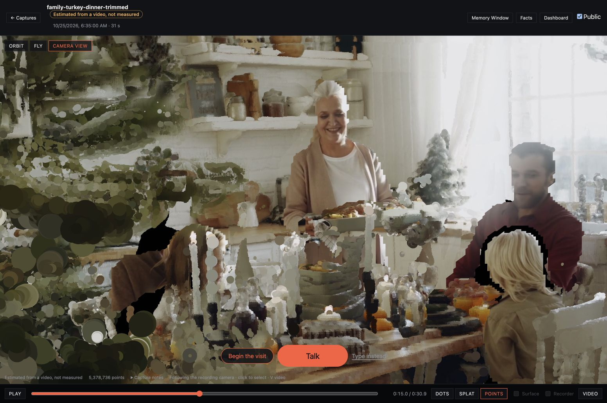
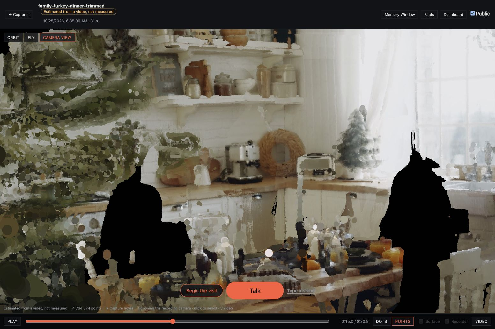
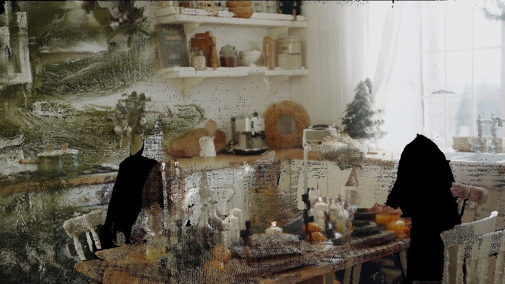
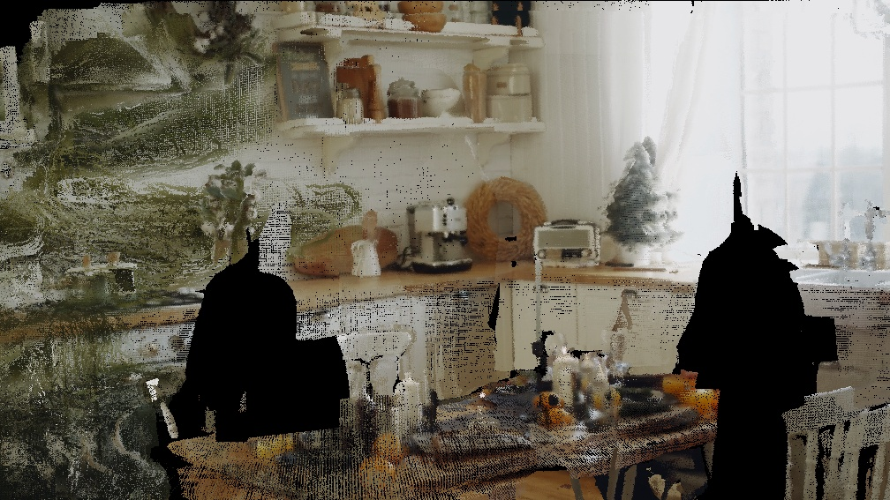

# Family dinner: static kitchen review

The dev memory `2ac42b66-4c0d-4962-9723-f359c34984ed` now explicitly prefers
`496f722d-1ca7-4a3f-818e-aa6b93d1c4b9`: **4,764,574 points**, down from 5,378,736.
Representation: connected **Points**. The alternative has no splat and no depth-indexed
camera frames, so 3D people replay cannot appear. The original source video remains available.

[Review the same memory](http://127.0.0.1:5174/#/capture/2ac42b66-4c0d-4962-9723-f359c34984ed?t=15),
then choose **Camera view**. This is the existing Mac frontend connected to the dev backend.
The preferred package is backend data, so other frontends connected to that backend resolve it too.

## What the recording supports

White cabinetry, a brick backsplash, open shelves, a stove, countertop appliances, a sink and
window, a Christmas tree, chairs, and a set dining table. No fixtures or hidden surfaces were
invented. Large gaps remain around the seated people and behind foreground occlusions. The
thin camera baseline cannot support walking around an entire kitchen; broad orbits expose the
missing backs of surfaces. Glassware, chair rails, the foreground tree and depth boundaries still
have speckling and soft edges. Reviewed exclusions also remove a few thin candle/branch pixels
where they overlap residual clothing. This is a cleaned partial reconstruction, not a complete room.

## Matching viewer comparison

Both images use the original memory, connected Points, the recorded camera at 15.0 seconds,
and the same 1552 × 1033 viewport. Before includes the original replay layer; after has neither
people replay nor the removed static person fragments. Rollback to automatic density selection
was exercised to capture the before image, then the final preference was restored.

Before:



After:



To isolate the geometry change from disabling replay, these diagnostic projections contain only
room.bin, using the same recorded camera at 15 seconds. The floating serving dish and clothing
fragments are removed; observed cabinets remain.





## Reproduce

Run in the existing converter environment, against the downloaded **original** package:

```sh
python tools/video2capture/clean_static.py /path/to/original \
  --out /path/to/new-package --cache /path/to/masks.npz \
  --exclude-regions tools/video2capture/recipes/family-kitchen.json
```

This uses CUDA Mask R-CNN on all 310 depth views, then checks the existing dense points against
unmasked color/depth evidence and clear rays reaching farther surfaces. It reuses the original
DA3 world and poses; no new long-video estimation or small-window alignment was performed.
Three reviewed, depth-bounded regions remove residual sleeve/hand fragments. The complete
counts, thresholds and exclusions are in [cleaning.json](cleaning.json). Rejection categories
overlap; subtract final count from original for the total **614,162 removed points**.

Fedora run artifacts are at `/tmp/family-kitchen/`: original, final, masks.npz, final.log and the
isolated deploy checkout. The shared GPU worker was not restarted or modified.

From `backend/`, with the existing worker environment:

```sh
bun scripts/import-reconstruction.ts 2ac42b66-4c0d-4962-9723-f359c34984ed /path/to/new-package
# After the bake and visual review, select the new UUID printed by the converter:
bun scripts/prefer-reconstruction.ts 2ac42b66-4c0d-4962-9723-f359c34984ed <new-scene-ID>
# Restore density selection (currently resolves to the untouched original):
bun scripts/prefer-reconstruction.ts 2ac42b66-4c0d-4962-9723-f359c34984ed auto
```

## Verification

- GPU output and diagnostic projections inspected at 5, 15 and 29 seconds.
- Real Brave viewer: matching before/after, reload persistence, playback from 15 to 30.9 seconds
  without people reappearing, and a short drag orbit. [Playback end](playback-end.jpg), [orbit](orbit.jpg).
- Backend deployed from this isolated checkout. Both `captures.get` and `public.capture` return
  the final preferred scene. Original manifest and raw file names/sizes/revisions match the
  pre-work snapshot. All 17 facts and their pending approvals match the saved snapshot exactly.
  No sessions were created or modified.
- Wooden hatches still resolves to `dd7d7f37-e83a-42cd-9db1-08885826840e`, 4,430,861 points;
  Hallway still resolves to `c512fccd-8c62-4de5-9a49-7a30c701b497`, 5,403,276 points.
- Backend: 154 tests passed, 13 existing environment-dependent skips; typecheck passed.
  The new integration test covers authorization, unrelated/incomplete-scene rejection, selection,
  gallery exclusion, rollback and fallback when the preferred scene becomes unavailable.
- Converter: 55 existing tests passed. The first isolated test invocation lacked the repository's
  sibling TypeScript codec test path; rerunning with the proper repository layout passed all 55.
- Web typecheck passed; lint completed with existing warnings. No frontend build or server started.
- T3 preview snapshots timed out twice. Used Brave; switched from stalled port 5173 to the
  already-running port 5174. The viewer is supplied by the existing sibling worktree; this change
  modifies no frontend source. Memory Window was not verified: its candidate page showed a blank
  canvas, so the visual acceptance above uses the capture viewer.
